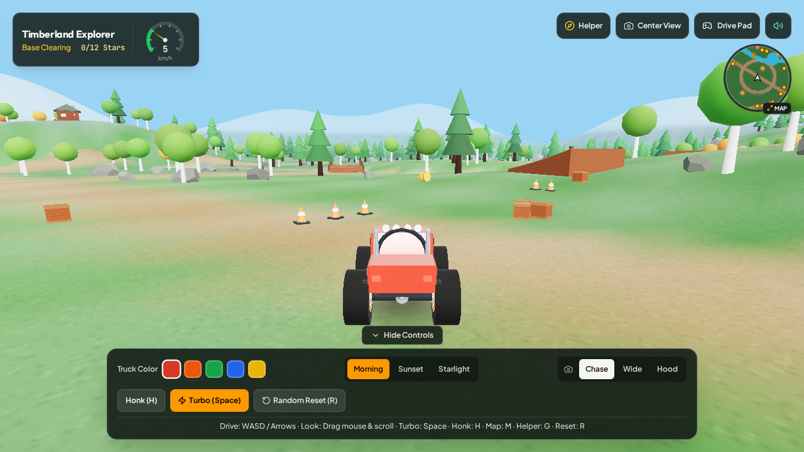
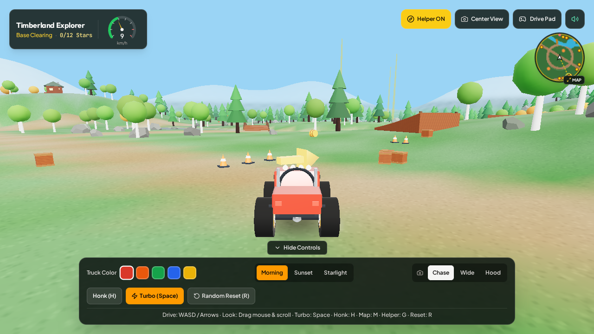
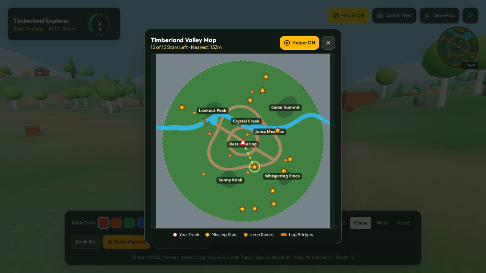
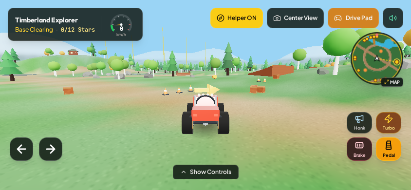

# Timberland Monster Truck Explorer

An open-world 3D mountain forest monster truck exploration game built for children in Google Chrome using **Three.js**, **WebGL**, **React**, and **TypeScript**. With no timers, fail states, or rigid walls, kids can freely drive, smash crates, splash through mountain creeks, spot forest animals, launch off stunt ramps, and hunt for randomized Golden Pine Stars across an alpine valley.



## Screenshots

### Helper Mode (3D Guide Arrow, Sky Beacons & Radar Guide)


### Interactive Full-Valley Big Map


### Mobile Landscape Touch Controls


## What the Game Can Do

### Open-World Mountain Forest (`800m × 800m` Drivable Valley)
- **Expansive Procedural Terrain**: Rolling sunlit meadows, winding dirt exploration loops, *Base Clearing*, *Crystal Creek*, *Lookout Peak*, *Jump Meadow*, *Whispering Pines*, *Cedar Summit*, *Sunny Knoll*, and snow-dusted perimeter ridges.
- **Full-Valley Crystal Creek & Alpine Ponds**: Continuous procedural water basins with animated shimmer ripples where driving into water triggers 3D splash droplets, 14 expanding water ripple rings, four-wheel wake plumes, a `SPLASH!` HUD badge, and synthesized splash audio.
- **Solid Trees & Mossy Boulders**: Every pine tree, birch tree, and granite boulder has solid trunk/rock collision with smooth sliding deflection so the truck feels grounded without getting permanently trapped.
- **30 Smashable Props**: Wooden crates, golden hay bales, and bright traffic cones scattered along trails and ramp approaches fly spinning through the air when hit and gently respawn after a few seconds.
- **16 Animated Forest Animals**: Friendly deer, foxes, and pond ducks roam meadows and creek banks—honk or drive close to make them perk up, hop, or chirp back!
- **3 Arched Wooden Log Bridges & 10 Stunt Ramps**: Built directly into the continuous drivable heightfield for creek crossings and high-flying jumps.
- **12 Randomized Golden Pine Stars & Fireworks Celebration**: Each session or reset spawns 12 glowing stars at fresh locations. Collecting all 12 launches colorful sky fireworks bursts, celebration fanfare audio, and a **Play Again!** banner.

### Monster Truck Physics & Customization
- **Realistic 4-Corner Suspension & Ramp Jumping**: Independent four-wheel ground-contact ray/height sampling, pitch/roll spring-damper physics, airborne ballistic arcs, squash-and-bounce landings, and treaded oversized tires.
- **Customizable Paint & Time of Day**: Switch between 5 paint colors (*Trail Red*, *Timber Orange*, *Pine Green*, *Alpine Blue*, *Sunburst Gold*) and 3 lighting presets (*Morning*, *Sunset*, *Starlight*).

### Navigation, Mini-Map Radar, Big Map & Helper Mode
- **Live Mini-Map Radar**: Rotating truck-centered radar showing trails, water, bridges, ramps, and remaining stars.
- **Clickable Big Map (`M`)**: Tap the Mini-Map Radar (or press `M`) to open the full-valley **Timberland Valley Map** with labeled landmarks, bridges, ramps, truck heading, and missing star markers.
- **Kid-Friendly Helper Mode (`G`)**: Toggle **Helper** from the top bar, Big Map modal, or `G` key to activate:
  - A floating **3D golden arrow** above the truck pointing toward the nearest uncollected star.
  - Tall glowing **golden sky beacons** rising above every remaining star.
  - Dashed **golden route lines** and nearest-star distance readout on both the Mini-Map Radar and Big Map.

### Camera, HUD & Touch Controls
- **360° Mouse Look & Zoom**: Click and drag anywhere to orbit around the truck, scroll to zoom in/out, and double-click (or tap **Center View**) to recenter behind the truck. Switch between **Chase**, **Wide**, and **Hood** cameras.
- **Compact Live Tachometer**: Analog-style SVG RPM dial with digital `km/h` readout, current zone name, and star progress.
- **Mobile Landscape Drive Pad**: Left/right steering arrows on the left paired with **Honk**, **Turbo**, **Brake**, and **Pedal** icon controls on the right.
- **100% Procedural Web Audio**: Synthesized engine rumble, two-tone air horn, water splashes, prop smashes, animal chirps, landing thuds, star chimes, and firework bursts with one-tap mute.

## Controls

| Action | Input |
| --- | --- |
| Drive / Reverse | `W` / `S` or `Arrow Up` / `Arrow Down` |
| Steer Left / Right | `A` / `D` or `Arrow Left` / `Arrow Right` |
| Look Around (360°) | Click and drag mouse |
| Zoom In / Out | Mouse scroll wheel |
| Center Camera | Double-click canvas or click **Center View** |
| Turbo Boost | Hold `Space` |
| Monster Horn | `H` |
| Open / Close Big Map | `M` (or click the Mini-Map Radar) / `Esc` |
| Toggle Helper Mode | `G` (or click **Helper**) |
| Random Reset (Truck & Stars) | `R` |

## Tech Stack

- **3D Engine**: Three.js (`WebGLRenderer`, `RoomEnvironment` PBR lighting, `InstancedMesh`, procedural `CanvasTexture` maps)
- **Frontend**: React 19, TypeScript, Tailwind CSS v4, Vite
- **Audio**: Web Audio API procedural synthesizer (zero external audio or image dependencies)

## Project Structure

```text
src/
├── App.tsx                     # Canvas mount, keyboard bindings (WASD, H, M, G, R), and state wiring
├── components/
│   ├── BigMapModal.tsx         # Full-valley interactive map modal with landmarks & Helper guide
│   ├── HudOverlay.tsx          # Tachometer gauge, Helper toggle, touch drive pad, customization dock
│   └── MiniMapRadar.tsx        # Clickable rotating radar showing trails, water, ramps, and stars
└── game/
    ├── audio.ts                # Procedural Web Audio synth (engine, horn, splash, smash, chirps, fireworks)
    ├── engine.ts               # Three.js renderer, 4-wheel jump physics, particles, 3D helper arrow, camera
    ├── terrain.ts              # Analytical heightfield, continuous creek/lakes, trails, bridges, ramps
    ├── textures.ts             # Procedural canvas textures (tread, wood, bark, terrain, water ripples)
    ├── truck.ts                # Multi-part 3D Monster Truck rig and paint material controller
    ├── types.ts                # Shared TypeScript interfaces and color presets
    └── worldProps.ts           # Instanced forest, solid obstacles, smashables, animals, stars & beacons
```

## Running Locally

```bash
npm install
npm run dev
```

Open `http://localhost:3000` in Google Chrome.
